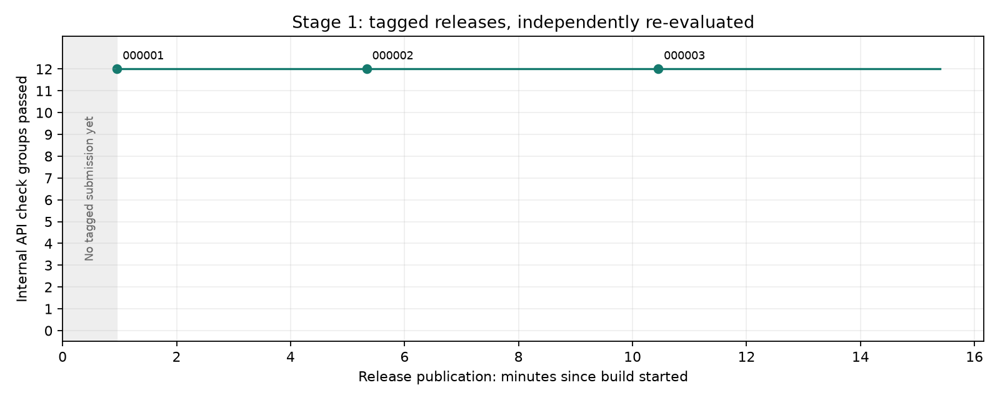
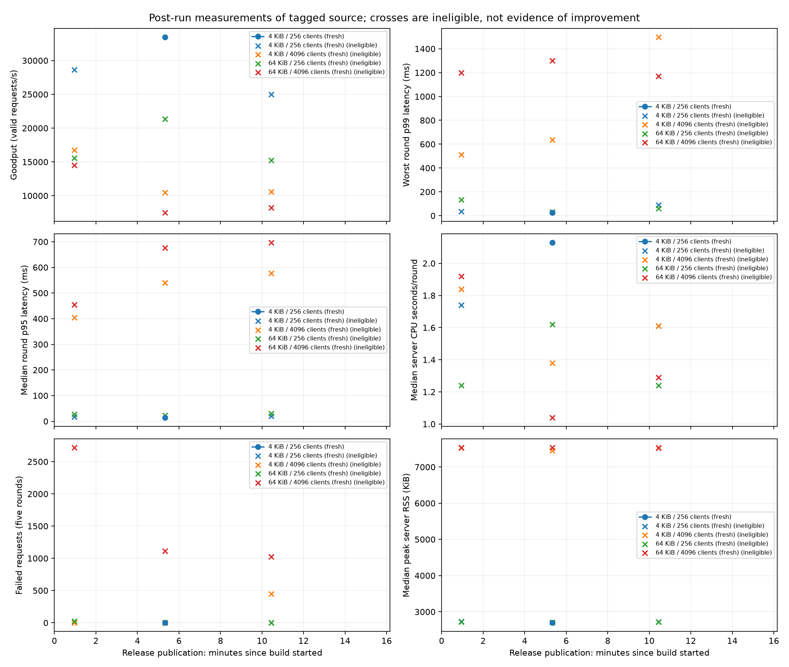

# Stage 1: held-out evaluation of Terra releases

Builder: Terra medium, standard processing, no starter. Only one ordinary GET smoke check was available during implementation. These are independent post-run measurements of all three tags.

Budget: $3 strict cap, two-hour ceiling. The builder stopped after 923.7 seconds at $0.265256 of accounted spend, because $2.734744 remaining could not cover the next $2.745 reservation. 25 model calls, 722650 input/output tokens including cached input.

All required internal API checks gate performance. Workloads: fresh HTTP connections; 4/64 KiB bodies; 256/4096 active clients; five rounds per workload, one-second warmup and three-second measurement.

The initial analysis failed during sandbox startup after two workload measurements of the first tag. It was preserved in the original run folder; these plots use the complete fresh retry, without mixing measurements from the two attempts. No model calls were made for evaluation.

Crosses mark ineligible measurements. Latency includes successful requests only and must be interpreted alongside failures, timeouts and generator saturation. Ineligible results do not establish a reliable performance improvement. The x-axis is release publication time; all plotted measurements were collected after the builder stopped.

| Tag | Published (minutes) | Internal API groups passed |
|---|---:|---:|
| release/000001 | 0.96 | 12/12 |
| release/000002 | 5.33 | 12/12 |
| release/000003 | 10.45 | 12/12 |

See metrics.csv for per-workload values and timeline.json for the raw round data. implementation.bundle contains the tagged Git history.
